



`🎒 full inventory`


  <a href="https://click-club-photobooth.vercel.app"></a>
  <a href="https://avril-abelarde.vercel.app"></a>
  <a href="https://avril-abelarde.vercel.app"></a>
  <a href="https://2048-game-seven-tau.vercel.app"></a>
  <a href="https://github.com/vrilrde/study-planner-v2"></a>
  <a href="https://github.com/vrilrde/inventory-system"></a>

more side quests at <a href="https://avril-abelarde.vercel.app">avril-abelarde.vercel.app</a> ˖⊹ miffy fits · intelligloves · openvetai · real estate platform





#### ▸ press any button to connect

`˖⊹ ࣪` Manila, PH &nbsp;·&nbsp; <code>avril@player01:~$ _</code>

